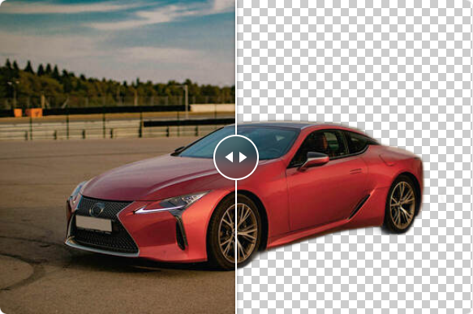

<div align="center">

<picture>
  <source media="(prefers-color-scheme: dark)" srcset="src/assets/img/readme-logo-dark.svg">
  
</picture>

A free, open-source background remover that runs entirely in your browser.<br>
Powered by WebGPU and WebAssembly. No uploads, no accounts, no cost.

[](https://github.com/siosond/remove-bg/releases)
[](https://github.com/siosond/remove-bg/issues)
[](https://github.com/siosond/remove-bg/issues)
[](https://github.com/siosond/remove-bg/blob/main/LICENSE)


[Features](#features) · [Getting started](#getting-started) · [Tech stack](#tech-stack) · [How it works](#how-it-works) · [License](#license)

<br>



</div>

## Features

- **Private by design.** Images are processed on your device and never uploaded.
- **Fast.** Uses WebGPU when the browser supports it and falls back to multi-threaded WebAssembly.
- **Light download.** The ~5 MB model is fetched once, then cached in your browser for later visits.
- **Easy input.** Drag and drop anywhere on the page, or pick a file.
- **Compare and customize.** Slide between the original and the result, then place the cutout on a transparent, solid or custom background color.
- **Export.** Download the result as a PNG.
- **Light and dark themes.**

## Getting started

### Prerequisites

- [Node.js](https://nodejs.org/) 22.12 or later

### Run locally

```bash
git clone https://github.com/siosond/remove-bg.git
cd remove-bg
npm install
npm run dev
```

Then open the local URL printed in the terminal.

### Scripts

| Command           | Description                                    |
| ----------------- | ---------------------------------------------- |
| `npm run dev`     | Start the Vite dev server                      |
| `npm run build`   | Type-check (`tsc -b`) and build for production |
| `npm run preview` | Preview the production build locally           |
| `npm run lint`    | Lint the sources with Biome                    |
| `npm run format`  | Format the sources with Biome                  |
| `npm run check`   | Run Biome lint, format and import checks       |
| `npm test`        | Run the unit tests with Vitest                 |

## Tech stack

| Layer         | Technologies                                                                                                                 |
| ------------- | ---------------------------------------------------------------------------------------------------------------------------- |
| UI            | React 19, TypeScript 6, shadcn/ui (Radix UI), Tailwind CSS 4, lucide-react, sonner, next-themes, react-compare-slider, Inter |
| Build & tools | Vite 8, Vitest, Testing Library (jsdom), Biome                                                                               |
| ML runtime    | ONNX Runtime Web (`onnxruntime-web/webgpu`), ndarray                                                                         |
| Storage       | localforage (IndexedDB) for the cached model                                                                                 |
| Model         | [U²-Net](https://github.com/xuebinqin/U-2-Net) lightweight variant (`u2netp.onnx`, ~5 MB, Apache-2.0), shipped with the app  |

## How it works

1. **Model download.** On first load, `Download.tsx` fetches `u2netp.onnx` from the app's own `public/models/` folder (URL in `src/assets/script/config.ts`) with a progress dialog and stores it in IndexedDB through `model.ts`. Later visits read it straight from the cache.
2. **Runtime setup.** `utils.ts` checks for WebGPU and WebAssembly threads, and `inference.ts` creates the ONNX Runtime session on WebGPU when available, otherwise on WASM.
3. **Inference.** The image is resized to 320 × 320 with bilinear interpolation, normalized, converted from HWC to BCHW layout and passed to the model. The output saliency mask is min-max normalized.
4. **Compositing.** The mask is scaled back to the original size and written into the image's alpha channel. `Preview.tsx` draws the result over the chosen background and exports it as a PNG.

### Project layout

```text
src/assets/script/      Model storage, inference pipeline, runtime utilities, config
src/components/         App components (upload, preview, background picker, ...)
src/components/ui/      shadcn/ui primitives
public/models/          Bundled U²-Net model with its license and notice
```

## License

Released under the [GNU GPL v3.0](LICENSE).

The bundled model and other third-party material keep their own licenses. See [THIRD-PARTY-NOTICES.md](THIRD-PARTY-NOTICES.md).

## Acknowledgements

This project is a fork of [daxmeng/remove-bg](https://github.com/daxmeng/remove-bg).

Background removal is powered by [U²-Net](https://github.com/xuebinqin/U-2-Net) by Xuebin Qin et al., released under the Apache License 2.0. The bundled `u2netp.onnx` is the export from [rembg](https://github.com/danielgatis/rembg)'s release assets; its license text and origin are in [`public/models/`](public/models/NOTICE).

<details>
<summary>Citation (BibTeX)</summary>

```bibtex
@InProceedings{Qin_2020_PR,
title = {U2-Net: Going Deeper with Nested U-Structure for Salient Object Detection},
author = {Qin, Xuebin and Zhang, Zichen and Huang, Chenyang and Dehghan, Masood and Zaiane, Osmar and Jagersand, Martin},
journal = {Pattern Recognition},
volume = {106},
pages = {107404},
year = {2020}
}
```

</details>
